  

# 🏭 Awesome-Manufacturing-CRM 🚀

  
  
  
  
  
  

---

## 🧭 Top Manufacturing CRM Tools Ecosystem 🛠️

**Curated List of SaaS Products & Open-Source GitHub Projects**  
*Focused on Production Planning, BOM Management, Shop Floor Execution (MES) & Manufacturer-Customer Relationships (CPQ)*  
**Last updated: March 2026**

This repository is an authoritative, SEO-optimized directory tracking enterprise **SaaS platforms**, industry-specific **ERP/CRM suites**, and community **open-source projects** for **Manufacturing CRM**. In modern industrial manufacturing, traditional generic sales CRMs fail to address the complex requirements of production: connecting configure-price-quote (CPQ) workflows to multi-level bills of materials (BOM), coordinating job shop scheduling, syncing distributor portals, tracking work-in-progress (WIP) on the factory floor, and servicing aftermarket warranty claims.

Whether you operate a discrete manufacturing facility, job shop, CNC machining business, or develop data-sovereign manufacturing systems, this guide catalogs both market-leading proprietary suites and extensible self-hosted codebases.

---

## 📑 Table of Contents
- [📊 Sector Overview & Market Dynamics](#-sector-overview--market-dynamics)
- [☁️ SaaS & Enterprise Hosted Platforms](#️-saas--enterprise-hosted-platforms)
- [💻 Open-Source GitHub Projects](#-open-source-github-projects)
- [🧩 Frameworks for Custom Implementations](#-frameworks-for-custom-implementations)
- [🤝 How to Contribute](#-how-to-contribute)
- [⭐ Star History](#-star-history)
- [💖 Support & Sponsorship](#-support--sponsorship)
- [⚖️ Disclaimer](#️-disclaimer)

---

## 📊 Sector Overview & Market Dynamics

The global manufacturing CRM and operational software sector represents an estimated market size of **$18.5 Billion to $22.4 Billion (expanding at ~12.8% CAGR)**, driven by industrial digital transformation (Industry 4.0), demand for supply chain visibility, and intelligent configure-price-quote (CPQ) automation. 

The sector is **moderately to highly fragmented** rather than a winner-take-all monopoly: while mega-cap hyperscalers (Salesforce, Microsoft Dynamics) anchor enterprise Fortune 500 sales agreements, mid-market discrete and process manufacturing remains heavily distributed among specialized ERP/CRM vendors (Epicor, Infor, Katana, JobBOSS) alongside an accelerating wave of extensible, data-sovereign open-source platforms (ERPNext, Odoo, InvenTree).

---

## ☁️ SaaS & Enterprise Hosted Platforms

The table below catalogs premier SaaS & Cloud ERP/CRM platforms tailored for manufacturing workflows. Platforms are sorted in **descending order by company scale (Revenue / Valuation)**.

| Platform / Vendor | Scale (Revenue / Valuation) | Starting Tier Pricing | Free Tier / Trial Limit | Key Manufacturing & CRM Highlights |
| :--- | :--- | :--- | :--- | :--- |
| **[Microsoft Dynamics 365 Supply Chain](https://www.microsoft.com/en-us/dynamics-365)** | **$245B+ Annual Revenue** (Microsoft Cloud ecosystem) | **$180 per user/month** (Dynamics 365 Supply Chain Management base) | **30-day full feature trial** (Includes sample manufacturing tenant & sandbox access) | Enterprise-scale ERP and CRM unification with real-time shop floor execution, planning optimization, and asset management. |
| **[Salesforce Manufacturing Cloud](https://www.salesforce.com/)** | **$38B+ Annual Revenue** ($280B+ Market Cap) | **$275 per user/month** (Enterprise Manufacturing Cloud edition) | **30-day guided interactive trial** (Pre-populated manufacturing scenario data & quote templates) | Industry-standard CRM featuring sales agreement run-rate commitments, account-based forecasting, and distributor relationship management. |
| **[Infor CloudSuite Manufacturing](https://www.infor.com/)** | **$3.5B+ Annual Revenue** (Koch Industries subsidiary) | **~$150 per user/month** (Quoted via annual enterprise deployment tier) | **Interactive guided test sandbox** (No self-serve persistent free tier) | Multi-facility discrete & process manufacturing ERP with embedded CRM, supply chain planning, and field service management. |
| **[Epicor ERP (Kinetic)](https://www.epicor.com/)** | **~$1.1B Annual Revenue** (~$4.7B Valuation) | **~$120 per user/month** (Per user core subscription model) | **14-day guided proof-of-concept trial** (Access through partner/sales onboarding) | Make-to-order (MTO) and engineer-to-order (ETO) specialist featuring CPQ, visual production scheduling, and nested BOM routing. |
| **[Plex Systems](https://www.plex.com/)** | **~$350M Annual Revenue** (Rockwell Automation division) | **~$200 per user/month** (Smart Manufacturing Cloud suite) | **Guided testbed demo environment** (Sales-validated proof-of-concept period) | Cloud-native MES & ERP integration offering real-time shop floor telemetry, production tracking, and quality management. |
| **[QAD Adaptive ERP](https://www.qad.com/)** | **~$340M Annual Revenue** (Thoma Bravo portfolio) | **~$135 per user/month** (Adaptive enterprise subscription) | **Guided demo & trial instance** (Provided on request for qualified manufacturing teams) | Adaptive ERP engineered for automotive, life sciences, and high-tech manufacturing with supplier & customer portal automation. |
| **[Fishbowl](https://www.fishbowlinventory.com/)** | **~$120M Annual Revenue** | **$329 per month** (Fishbowl Drive / Manufacturing base plan) | **14-day free trial** (Full manufacturing, work orders & QuickBooks sync capabilities) | High-velocity inventory control and light manufacturing software featuring job tracking, BOMs, and barcode scanning. |
| **[JobBOSS²](https://www.jobboss.com/)** | **~$95M Annual Revenue** (ECi Software group) | **$140 per user/month** (JobBOSS² cloud standard tier) | **Interactive product tour & custom trial** (On-demand test workspace with sales demo) | Custom job shop ERP & CRM designed for contract manufacturers with estimating, fast quoting, scheduling, and tracking. |
| **[Rootstock Software](https://www.rootstock.com/)** | **~$60M Annual Revenue** (Gryphon Investors backed) | **$175 per user/month** (Manufacturing Cloud on Salesforce) | **30-day Salesforce AppExchange test drive** (Pre-configured sandbox environment) | Native Salesforce Manufacturing ERP integrating customer opportunities directly into production work orders and MRP. |
| **[Katana Cloud Manufacturing](https://katanamrp.com/)** | **~$35M ARR** (~$250M Valuation) | **$359 per month** (Standard plan billed annually, includes 3 users) | **14-day free trial** (No credit card required; full access to live shop floor app & BOM builder) | Visual production planning and inventory CRM built for scaling modern SME manufacturers, eCommerce makers, and workshops. |

---

## 💻 Open-Source GitHub Projects

The following self-hosted and open-source solutions provide full code sovereignty, auditable production workflows, and zero vendor lock-in. 

Projects are sorted in **descending order by GitHub Star count** 🌟. Click any star badge to inspect the repository stargazers.

| Project & Repository | GitHub Stars Badge | Primary License | Architecture & Focus |
| :--- | :---: | :---: | :--- |
| **[Twenty](https://github.com/twentyhq/twenty)** |  | AGPL-3.0 | Modern CRM with extensible data models, REST/GraphQL APIs, and custom pipeline workflows adaptable for industrial B2B sales pipelines. |
| **[Odoo](https://github.com/odoo/odoo)** |  | LGPL-3.0 | Comprehensive modular suite featuring MRP, Work Centers, Routing, PLM, CPQ, Maintenance, and full customer lifecycle pipelines. |
| **[ERPNext](https://github.com/frappe/erpnext)** |  | GPL-3.0 | Python/Frappe ERP with end-to-end multi-level BOMs, capacity planning, job cards, subcontracting, and deep sales pipeline linkage. |
| **[Krayin CRM](https://github.com/krayin/laravel-crm)** |  | MIT | Modular PHP/Laravel CRM designed for high performance, custom entities, sales lead tracking, and manufacturing quote follow-ups. |
| **[Dolibarr](https://github.com/Dolibarr/dolibarr)** |  | GPL-3.0 | Lightweight ERP/CRM engine for small enterprises with production orders, stock tracking, shipments, and customer invoicing. |
| **[InvenTree](https://github.com/inventree/InvenTree)** |  | MIT | Powerful Python/Django inventory and manufacturing tracking platform with BOM management, purchase orders, build orders, and supplier linking. |
| **[SuiteCRM](https://github.com/salesagility/SuiteCRM)** |  | AGPL-3.0 | Battle-tested enterprise CRM framework adaptable for manufacturer accounts, distributor networks, and ERP syncing via REST APIs. |
| **[EspoCRM](https://github.com/espocrm/espocrm)** |  | GPL-3.0 | Fast, flexible SPA CRM with BPM workflow automation, custom relations, order tracking, and field-level access control. |
| **[metasfresh](https://github.com/metasfresh/metasfresh)** |  | GPL-2.0 | Java/OSGi enterprise ERP built for mass-transaction manufacturing, supply chain tracking, automated scheduling, and CRM workflows. |
| **[PartKeepr](https://github.com/partkeepr/PartKeepr)** |  | GPL-3.0 | Electronic and mechanical component inventory and manufacturing assembly tracker with part parameterization and stock allocation. |
| **[Craftplan](https://github.com/puemos/craftplan)** |  | AGPL-3.0 | Elixir/Phoenix ERP custom-crafted for artisanal and small-batch production with versioned BOM cost rollups, batching, and order CRM. |
| **[Apache OFBiz](https://github.com/apache/ofbiz-framework)** |  | Apache-2.0 | Proven Apache software foundation business application suite with manufacturing MRP, catalog pricing, and sales lifecycle features. |
| **[qcadoo MES](https://github.com/qcadoo/mes)** |  | AGPL-3.0 | Dedicated web-based manufacturing execution system (MES) for small-to-medium factories with work orders, scheduling, and quality checks. |
| **[MyCompany](https://github.com/lsfusion-solutions/mycompany)** |  | Apache-2.0 | Built on the lsFusion platform; unifies BOMs, work centers, Kanban pipelines, customer orders, and raw material procurement in one app. |
| **[Tryton](https://github.com/tryton/tryton)** |  | GPL-3.0 | Highly modular three-tier architecture featuring production routing, lead management, BOM calculations, and supply chain tracking. |
| **[OpenMES](https://github.com/mes-open/openMES)** |  | MIT | Lightweight shop-floor execution system with packaging/EAN barcode scanning, terminal interfaces, and manufacturing work order dispatches. |
| **[Celerp](https://github.com/celerp/celerp)** |  | MIT / Elastic | Cloud-native ERP with modern tech stack, modular CRM pipelines, purchase orders, inventory, and discrete production modules. |
| **[OpenQMS](https://github.com/c-realize/openqms)** |  | AGPL-3.0 | Cloud-native Quality Management System (QMS) ensuring regulatory compliance (ISO 9001/IATF) connected to customer claims and CAPA workflows. |
| **[OpenCore MES](https://github.com/opencore-mes/opencore-mes)** |  | Apache-2.0 | Modern low-code MES foundation supporting cryptographic audit trails, policy-driven manufacturing, and API-first hardware connectivity. |
| **[Carbon](https://github.com/teristit/carbon)** |  | MIT | Open-source configure-to-order manufacturing platform designed for complex assemblies, nested multi-level BOMs, and engineer-to-order pipelines. |

---

## 🧩 Frameworks for Custom Implementations

When engineering a tailored, self-hosted manufacturing tech stack, industry best practices favor composing best-of-breed modules:

- **ERP Core Backbone**: [ERPNext](https://github.com/frappe/erpnext) or [Odoo](https://github.com/odoo/odoo)
- **Dedicated B2B Customer Pipeline**: [Twenty](https://github.com/twentyhq/twenty) or [EspoCRM](https://github.com/espocrm/espocrm)
- **Component & Inventory Allocation**: [InvenTree](https://github.com/inventree/InvenTree) or [PartKeepr](https://github.com/partkeepr/PartKeepr)
- **Shop Floor Execution & Terminals**: [OpenMES](https://github.com/mes-open/openMES) or [qcadoo MES](https://github.com/qcadoo/mes)
- **Telemetry & Production BI**: Metabase, Apache Superset, or Grafana backed by PostgreSQL / TimescaleDB.

---

## 🤝 How to Contribute

Contributions from manufacturing developers, industrial automation engineers, and operations specialists are always welcome! 🌟

1. 🍴 **Fork** this repository.
2. 🌿 Create a topic branch: `git checkout -b feature/add-new-tool`.
3. 📝 Add your tool to the table (maintain ascending/descending sorting criteria and explicit pricing/star details).
4. ✅ Ensure links point directly to official documentation or source code.
5. 🚀 Submit a descriptive **Pull Request**.

---

## ⭐ Star History

---

## 💖 Support & Sponsorship

If this curated manufacturing repository assists your company, team, or projects, please consider showing your support:

- ⭐ **Star this repository** to help others discover it!
- 🍴 **Fork & share** with fellow developers and manufacturing professionals.
- ☕ **Sponsor or buy a coffee**: Support ongoing curation and maintenance via the [GitHub Sponsor Dashboard](https://github.com/sponsors/ishandutta2007).

Your support keeps this ecosystem directory accurate, comprehensive, and up to date! ❤️

---

## ⚖️ Disclaimer

- This curated directory is maintained for informational and educational purposes. Mention of proprietary products does not constitute an official endorsement or certification.
- Manufacturing information systems frequently handle sensitive intellectual property, CAD models, export-controlled data (ITAR/EAR), and must comply with safety regulations (ISO 9001, IATF 16949, AS9100) and data privacy frameworks (GDPR, CCPA).
- Self-hosted open-source software should undergo rigorous network hardening, automated backups, and access reviews before production shop-floor deployment.

---

  <b>Built with ❤️ for industrial engineers, operations leaders, shop managers, and developers building the future of manufacturing software.</b>

